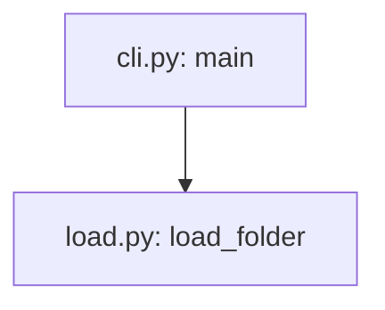

# Writing pages

## Page kinds

Each page serves one purpose, so a reader knows whether they are learning, doing, looking something up, or trying to understand ([Diátaxis](https://diataxis.fr/)). The root README is the front page. Readers never see the kind names: the index and the viewer use the labels documentation sites use.

| Kind | Readers see | Folder | Answers | Examples |
|---|---|---|---|---|
| front page | Start here | the root `README.md` | what is it; how do I set it up, run, test and debug it | setup, run, debug, tests, layout, docs map |
| tutorial | Tutorials | `start/` | walk me through it once | trace one request through the code |
| explanation | How it works | `concepts/` | how is it put together, and why | the overview; how a request works; why the cache is keyed by content |
| how-to | Guides | `howto/` | how do I … | run and debug; add a format; deploy |
| reference | Reference | `reference/`, or a folder named for the thing, such as `pipelines/`, `api/` or `cli/` | what exactly does X do | a pipeline, the configuration keys, the result format |

`SCHEMA.md` and `log.md` are for the wiki's maintainers. The viewer keeps them out of the reading pages and links them from its footer.

## The overview page

`concepts/overview.md`, titled "How {project} fits together", comes first under "How it works". It is the map of the whole system that the other pages go deep from, and it covers every part, not only the one the first build follows. Its sections:

1. **What it does.** What a user gets from the project, as a short list in their words, grouped the way the project groups it (its commands, screens, endpoints or features). Each item links to the page that covers it, where one exists.
2. **The parts.** A table `Part | What it does | Built on | Where it lives | How you reach it`. A part is what a newcomer would name: the command line, the API server, the web app, the database, the worker, the library's client. Describe it in words; the folder and the entry point come after, not instead. "Built on" names the framework, library or method that does the part's work (FastAPI, PostgreSQL full-text search, an ISO standard), so a reader knows what to look up.
3. **How they fit.** One diagram of the parts and what passes between them, such as an HTTP request, SQL, a file or a queue message (§Diagrams). A box may add a second line with what the part is built on and its folder.
4. **One request, end to end.** A typical use followed across the parts in a few numbered steps, at the level of parts, each linking the how-it-works page that owns the detail. The steps inside a part are told there, not here.
5. **The code to know first.** A table `Code | What it decides | Open it when`, ranked by how much of the result each function decides. First the functions that compute or decide the project's main result: in a calculation, the steps that produce its numbers; in a service, the functions that decide which records match and how the answer is built. Then the function that runs the core flow end to end, and the entry point where a request or a command comes in. Application setup, registries and error plumbing are left out: a reader reaches them from the entry point. Each `Code` cell links the function's file. The test: someone who reads only the functions in this table can explain how the main result comes about.
6. **Where to go next.** Two or three links by task: set it up, debug it, change it.

The test: a newcomer who reads only this page can say what each part does, which part to open for a given task, and which few functions to read first.

## How-it-works pages

Each core flow gets one page, `concepts/how-<flow>-works.md`, started from `templates/how-it-works.md.tmpl`. A core flow is what the project exists to do: the calculation behind its main result, the path of a request through its server, the loop that schedules its jobs. Most projects have one to three. The page is the wiki's one home for that flow's steps, methods and code; the overview links to it, and run-and-debug points into its call map. Its sections:

1. **What goes in and what comes out**, and the method at the core, in one or two sentences.
2. **Think of it as …** An everyday picture of the flow that a newcomer already understands, such as a library catalogue for a search index or a relay race for a pipeline of workers, in two to four sentences. A table `In the picture | In the code | Where the picture stops fitting` ties each part of the picture to a step, and names where the picture would mislead. A picture that fits only loosely is worse than none; leave the section out rather than force one.
3. **The pipeline map.** One diagram from the input to the output. Each step's box has three lines: the step in words, the method it applies (a named algorithm, a standard and its clause, a formula, a rule such as "retry with back-off"), and `file: function`. Each arrow names what passes: the data, its type or shape. Under it, a table `# | Step | Method | Code | Takes | Gives | In the example`, where the diagram has the short names and the table the detail, the Code cell links every function that does the step's work (a reader, or an agent quoting the table, takes the links and drops bare names), and the example column carries values from a captured run of one real input, so the reader can follow numbers through the steps.
4. **Who calls whom.** The call map: the functions of the flow, from its entry to the code that does the work, each box `file: function`, each solid arrow a direct call (§Diagrams, "Call maps"). Start it from `python <tools folder>/wiki.py callgraph <path>#<core function>` for Python, which reads the calls from the code, and keep the boxes a reader needs: the main path and the functions that hold real logic, not every helper. Draw indirect calls (a registry lookup, a callback, a call into another process) dotted, with how they are reached on the arrow.
5. **The rules that decide the result.** The formulas, thresholds and decision rules, each with the function it lives in. Where a design document derives them, link it instead of copying the derivation.
6. **Why it is built this way**, only for decisions a reader would otherwise question or undo.

Name the method only as the code or its documents name it: a docstring, a comment, a reference in the code, or a design note. A method you recognise but the project never names is described in words, not given a name it may not follow.

The test: from this page alone, a newcomer can name each step, the method it applies, the function and file that do it, and what each step takes and gives, and can say where in the code to look when one number in the result is wrong.

## Page template

```text
---
title: <name>
kind: tutorial | how-to | reference | explanation
sources: [<path>#<Symbol>, <path>#<Class.method>, <path>]
updated: YYYY-MM-DD
---
# <name>
One or two sentences: what this page answers.
## …sections…
```

`sources:` may also be a block list, one `- <path>#<Symbol>` per line. There is no closing list of sources: the front matter holds them, GitHub shows front matter as a table, and the viewer lists them as "Code this page explains". Link a file in the text where the reader needs to open it.

## Rules

- **Sources are symbols, never line numbers.** Write `src/app.py#Engine.run`, `web/server.ts#Router.route`, `cmd/main.go#Server.Start`, `README.md#setup` (a heading). Line numbers drift; the lint resolves every symbol and fails when one no longer exists. A whole file is just its path. Python is checked exactly, with its parser; other languages are matched against their definition syntax, which can miss an unusual form. If a real symbol is reported missing, name the enclosing definition instead.
- **Every claim is traceable** to a source symbol, a captured output, or the user. Name each symbol the page explains in `sources:`.
- **Captured, expected, or illustrative.** Output shown as real was pasted from a run or a file. Label it with its origin, for example "Captured on 2026-10-23 from `app --trace sample.csv`, shortened", or "Captured: `tests/golden/report.txt`". `wiki.py lint --run --capture <folder>` saves the output of every `check:run` block for this. When a command cannot run here, output worked out from the code is still useful: label it "Expected, from `<path>#<Symbol>` (not captured)", and replace it with the captured output once the command runs. Any other example is labelled "Illustrative". Never type output by hand and present it as captured.
- **Plain and exact.** Define a term before using it; no private shorthand. Prefer a table to prose for anything a reader looks up. Short sentences, active voice.
- **Headings say the point**, in the reader's words, not the name of a rule in the code. "If a setting is set in more than one place", not "Which value wins"; "What happens when every model fails", not "Fallback semantics". The test: someone who reads only the headings learns what the page says.
- **The consequence first, then the reason.** Open a section with what the reader should do or expect, with one concrete example; the mechanism follows for those who need it. For example: "Setting `os.environ["LLM_MODEL"]` after the import changes nothing: pass `model=` instead. The value is read once, at import…".
- **One home per fact.** A table, list or procedure is written in full in one place: settings and flags on a reference page, a procedure on its how-to page, setup in the README, a flow's steps on its how-it-works page. Another page gives only the part its reader needs for the task at hand, with a link to the rest, never a second full copy. This holds for prose in other words too: a flow told in the overview, on its how-it-works page and again on run-and-debug is three copies, so the overview tells it at the level of parts, the how-it-works page owns the steps and the code, and run-and-debug owns where to break. The test: a reader in the middle of a task finishes it without opening another page, and a change in the code needs the fact edited in one place. `wiki.py lint` warns about a table that repeats most rows of a table on another page, and a diagram that repeats another; a fact repeated in other words is found by reading (`build.md` §5).
- **Say it once, briefly.** A sentence stays when the reader would lose something without it. Cut one that restates its heading, the table or diagram beside it, or another page; cut an opening that says who the page is for or what other pages cover, beyond the one or two sentences that say what this page answers. A long fact that another page owns becomes a link with the one line the reader needs here. `wiki.py lint` reports the words a reader has to read and the longest pages, so growth is visible; there is no fixed limit, and a page is as long as its facts need.
- **Links are relative.** Between pages, `../howto/run-and-debug.md`; to code, the file's relative path; to a section, `page.md#heading-slug`.

## Diagrams

- Write each diagram as a fenced `mermaid` block whose first line is `%% id: <name>`, using lowercase letters, digits and hyphens. Ids are unique across the wiki.
- The page shows the rendered SVG and keeps the source in a collapsed block below it. GitHub renders Mermaid, but VS Code's built-in Markdown preview and many other viewers show only the code. The markup, with a blank line after the summary line so GitHub renders the block's content:

````text


<details><summary>Diagram source</summary>


</details>
````

- Put every node label and edge label in double quotes. Labels contain no `;`, `<`, `>` or `#`, apart from `<br/>` between the lines of a box; a sequence-diagram message contains no `;`. Unquoted `()` or a node id named `end` break flowcharts.
- **Draw what a reader needs to see, in words.** A box names a part ("API server", "search index") or a step ("check the request", "wait, then retry"); an edge says what passes or when ("HTTP JSON", "on a 429"). The diagrams worth drawing are the parts and what flows between them (the overview), a core flow's pipeline and call map (its how-it-works page), the steps of a decision or a loop (a retry, a fallback, a cache), and the states something goes through. A diagram that only repeats the table next to it is left out.
- **Boxes that name code end with `file: function`** on their last line, as in `"Dynamic factor<br/>ISO 6336 Method B<br/>part1_factors.py: kv_method_b"`. The path may be shortened to any tail that names one file, and `a.py: f and g` names two functions. `wiki.py lint` fails when the file or function no longer exists, and warns when the page's `sources:` leaves that code out, so a change to it would not flag the page.
- **Call maps.** A diagram whose second line is `%% calls` is a call map: each solid arrow between two code boxes says the first function calls the second, and `wiki.py lint` warns when the callee's name no longer appears in the caller's code (for Python, also through an import alias). An indirect call (a registry lookup, a callback, a call into another process, a method reached through an object whose type the reader must know) is drawn dotted, `-.->`, with how it is reached on the arrow; dotted arrows are not checked. `wiki.py callgraph <path>#<function>` prints a call map read from Python code, with the calls it could not follow listed under it.
- **Each function-level map is drawn once**: a flow's pipeline map and call map on its how-it-works page. Run-and-debug and other pages link there rather than draw them again.
- Validate by rendering, not by eye: `wiki_browser.py render` fails on a diagram that does not parse. The SVG records a hash of its source, so lint also fails when the source changed and the SVG was not re-rendered.
- A diagram is part of the page: it changes in the same change as the code it shows.

## Command blocks

Every block a reader would paste into a terminal is either checked or skipped with a reason; `wiki.py lint --strict` fails on any other.

| Comment above the block | What `wiki.py lint --run` does |
|---|---|
| `<!-- check:run -->` | runs the `bash` or `powershell` block in a temporary clean checkout; a non-zero exit fails the lint |
| `<!-- check:run os=windows -->` (or `os=posix`, `os=linux,macos`) | the same, on that OS only; elsewhere it is reported as skipped |
| `<!-- check:run exit=1 -->` | the same, for a block that shows a failure on purpose, such as a start-up error in the symptom table: the block passes only if it ends with that exit code. Keep the failing command last, so the reader sees only what to type |
| `<!-- check:run background ready=http://127.0.0.1:8000/health -->` | starts the block as a service and waits until the URL answers below 500, or until `ready=/regex/` appears in its output, or `wait=<seconds>` passes. The page's later blocks can probe it, and it is stopped with its page |
| `<!-- check:output -->`, above the fenced output that follows a run block | the run block's output must contain these lines in order; `…` matches any text inside a line, and extra lines are allowed |
| `<!-- check:skip reason="needs an OpenAI API key" -->` | not run; the reason says what the step needs that a check cannot have. The viewer shows it to the reader above the block, so write it for them |

- Blocks run in order, the README first and then the pages by path, in one clean checkout of the current change. A later block may use what an earlier one set up, such as a virtual environment. Each block runs as one script and stops at its first failing command, in bash and in PowerShell 7.3 or later. Never add exit-code handling to a block to make a failure pass; mark it `exit=<code>` instead.
- With `--clean-env` the blocks run with only system variables (PATH, the home and temp folders, proxies). A step that needs a variable must set it in the block or say where the value comes from, such as copying `.env.example`.
- Mark as `check:run` only blocks that are safe to repeat and that finish on their own, apart from `background` services: no deploys to shared systems, no writes outside the checkout, no real credentials. When a stand-in exists (a mocked test, a local server, a dry run), show it as a run block next to the skipped real step.
- Where a step differs by OS, give each form and mark it with `os=…`.
- Output shown under a command should be real output marked `check:output`, with values that change on every run (times, ids, temporary paths) replaced by `…`.
- A block that installs packages needs network access; say so in the page's prerequisites.

## Run and debug

This is the page developers need most. Start from `templates/run-and-debug.md.tmpl`, and fill its sections in this order:

1. **Scope.** One or two sentences, and a link to the README's setup section. When the entry point needs something a default install lacks (`../../references/extraction.md` §2), such as a particular interpreter or host, or a service that must be running, give one line for each: what it is and how to provide it. The full steps stay in the README.
2. **Where to break.** A link to the call map on the how-it-works page, then a table `To see | Break in | Inspect | File`: one row per question a debugger answers, such as which branch was chosen, what the parsed input looks like, or what goes back to the caller, with the variables or expressions worth printing there. When the path from the entry point crosses layers the call map does not draw (a web client, a queue, a server's child process), draw only those layers here. Code that runs in another process (`extraction.md` §6, `other-process`) goes in a subgraph named for that process, and its row says how to reach it.
3. **Run each layer alone**, the fastest first: the core function from a short script or REPL, the command line on a sample input, the service with a test client, the whole system. Give each its command (marked `check:run` when safe) and how to attach a debugger: a named launch configuration, `python -m pdb`, `node --inspect-brk`, `dlv debug`, CodeLLDB. Name what misbehaves while the program is paused at a breakpoint, such as client timeouts, watchdogs, retries or heartbeats firing, and the setting that turns each off for a debugging session.
   - **Code in another process.** A breakpoint there never stops the debugger attached to the entry point, and nothing tells the reader why. Say where that code runs and how to reach it. That is either the switch that keeps it in one process (a worker count of 1, an in-process mode, `--no-reload`), or how to attach to the other process (debugpy's subprocess support, `--inspect` on the child). If neither exists, say so, and list adding a switch as a recommendation.
4. **Trace.** Document the switch the code already has (an environment variable or a flag), with a captured sample of its output, one line per stage. Say where the output goes when the host hides the program's output, such as a log file. If the code has no such switch, say so. Then give what the runtime or a library offers without a code change, for example `GODEBUG`, `NODE_DEBUG`, Python's `-X importtime` or logging configuration, a machine-readable output mode, or a verbose flag of an HTTP client, and list adding a real switch as a recommendation; that is a code change, outside the wiki.
5. **When it goes wrong.** A table `Symptom | Likely stage | Check`.
   - The first rows cover starting the program the wrong way, which is what a newcomer does first: the default interpreter instead of the one it needs, or a required service not running. Give the exact message, or how long it waits, and the fix.
   - Then the messages the code raises, the failure modes its tests cover, and the edge cases the code handles silently (a remainder dropped, a cap reached, a division by zero).
   - Where a command reproduces the symptom safely, give it, marked `check:run exit=<code>` (§Command blocks).
6. **Where each output value is set.** Include this when the program writes a structured result, such as a JSON or CSV file, a report, an API response or database rows. A table `Field | What it holds | Set in`, with one row per field a reader would question.
   - `Set in` is a link whose text is the symbol and whose target is its file, for example ``[`merge_signals`](../../src/pipeline.py)``. A wrong value in the output then leads straight to the function to break in.
   - Derive each row from the code that writes the field. When a reference page already describes the format, add the `Set in` column to its table and link it from here, instead of a second table (§Rules, "One home per fact").
   - `wiki.py lint` fails when a `Set in` symbol no longer exists. It warns when the last part of the field's name (`page` in `blocks[].page`) no longer appears in that symbol's code. So when the code changes, the table is flagged instead of drifting silently.
7. **Debug configurations.** The committed launch configurations by name, and what each runs.

Each level in step 3 is a line on what it shows, its command, and the debugger line; the "while paused" and "in another process" lines appear only where something applies.
