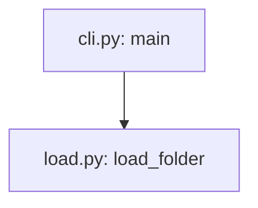

# Writing pages

## Page kinds

Each page serves one purpose, so a reader knows whether they are learning, doing, looking something up, or trying to understand ([Diátaxis](https://diataxis.fr/)). The root README is the front page.

| Kind | Folder | Answers | Examples |
|---|---|---|---|
| front page | the root `README.md` | what is it; how do I set it up, run, test and debug it | setup, run, debug, tests, layout, docs map |
| tutorial | `start/` | walk me through it once | trace one request through the code |
| how-to | `howto/` | how do I … | run and debug; add a format; upgrade a dependency |
| reference | `reference/`, or a folder named for the thing, such as `pipelines/`, `api/` or `cli/` | what exactly does X do | a pipeline, the configuration keys, the result format |
| explanation | `concepts/` | why is it built this way | how a request works; why the cache is keyed by content |

## Page template

```text
---
title: <name>
kind: tutorial | how-to | reference | explanation
sources: [<path>#<Symbol>, <path>#<Class.method>, <path>]
updated: YYYY-MM-DD
---
# <name>
One paragraph: what this page covers and who it is for.
## …sections…
## Sources
- [`<symbol>`](<relative path to the file>) in `<path>`: what it does
```

`sources:` may also be a block list, one `- <path>#<Symbol>` per line.

## Rules

- **Sources are symbols, never line numbers.** Write `src/app.py#Engine.run`, `web/server.ts#Router.route`, `cmd/main.go#Server.Start`, `README.md#setup` (a heading). Line numbers drift; the lint resolves every symbol and fails when one no longer exists. A whole file is just its path. Python is checked exactly, with its parser; other languages are matched against their definition syntax, which can miss an unusual form. If a real symbol is reported missing, name the enclosing definition instead.
- **Every claim is traceable** to a source symbol, a captured output, or the user. Name each symbol the page explains in `sources:`, and link the files in the closing Sources section.
- **Captured, expected, or illustrative.** Output shown as real was pasted from a run or a file. Label it with its origin, for example "Captured on 2026-10-23 from `app --trace sample.csv`, shortened", or "Captured: `tests/golden/report.txt`". `wiki.py lint --run --capture <folder>` saves the output of every `check:run` block for this. When a command cannot run here, output worked out from the code is still useful: label it "Expected, from `<path>#<Symbol>` (not captured)", and replace it with the captured output once the command runs. Any other example is labelled "Illustrative". Never type output by hand and present it as captured.
- **Plain and exact.** Define a term before using it; no private shorthand. Prefer a table to prose for anything a reader looks up. Short sentences, active voice.
- **Links are relative.** Between pages, `../howto/run-and-debug.md`; to code, the file's relative path; to a section, `page.md#heading-slug`.

## Diagrams

- Write each diagram as a fenced `mermaid` block whose first line is `%% id: <name>`, using lowercase letters, digits and hyphens. Ids are unique across the wiki.
- The page shows the rendered SVG and keeps the source in a collapsed block below it. GitHub renders Mermaid, but VS Code's built-in Markdown preview and many other viewers show only the code. The markup, with a blank line after the summary line so GitHub renders the block's content:

````text


<details><summary>Diagram source</summary>


</details>
````

- Put every node label and edge label in double quotes. Labels contain no `;`, `<`, `>` or `#`; a sequence-diagram message contains no `;`. Unquoted `()` or a node id named `end` break flowcharts.
- Label nodes with the real names (`file: symbol`), so a reader can find them in the code.
- Validate by rendering, not by eye: `wiki_browser.py render` fails on a diagram that does not parse. The SVG records a hash of its source, so lint also fails when the source changed and the SVG was not re-rendered.
- A diagram is part of the page: it changes in the same change as the code it shows.

## Command blocks

Every block a reader would paste into a terminal is either checked or skipped with a reason; `wiki.py lint --strict` fails on any other.

| Comment above the block | What `wiki.py lint --run` does |
|---|---|
| `<!-- check:run -->` | runs the `bash` or `powershell` block in a temporary clean checkout; a non-zero exit fails the lint |
| `<!-- check:run os=windows -->` (or `os=posix`, `os=linux,macos`) | the same, on that OS only; elsewhere it is reported as skipped |
| `<!-- check:run background ready=http://127.0.0.1:8000/health -->` | starts the block as a service and waits until the URL answers below 500, or until `ready=/regex/` appears in its output, or `wait=<seconds>` passes. The page's later blocks can probe it, and it is stopped with its page |
| `<!-- check:output -->`, above the fenced output that follows a run block | the run block's output must contain these lines in order; `…` matches any text inside a line, and extra lines are allowed |
| `<!-- check:skip reason="needs an OpenAI API key" -->` | not run; the reason says what the step needs that a check cannot have |

- Blocks run in order, the README first and then the pages by path, in one clean checkout of the current change. A later block may use what an earlier one set up, such as a virtual environment. Each block runs as one script and stops at its first failing line.
- With `--clean-env` the blocks run with only system variables (PATH, the home and temp folders, proxies). A step that needs a variable must set it in the block or say where the value comes from, such as copying `.env.example`.
- Mark as `check:run` only blocks that are safe to repeat and that finish on their own, apart from `background` services: no deploys to shared systems, no writes outside the checkout, no real credentials. When a stand-in exists (a mocked test, a local server, a dry run), show it as a run block next to the skipped real step.
- Where a step differs by OS, give each form and mark it with `os=…`.
- Output shown under a command should be real output marked `check:output`, with values that change on every run (times, ids, temporary paths) replaced by `…`.
- A block that installs packages needs network access; say so in the page's prerequisites.

## Run and debug

This is the page developers need most. Start from `templates/run-and-debug.md.tmpl`, and fill its sections in this order:

1. **Scope.** One paragraph, and a link to the README's setup section.
2. **The call chain, and where to break.** A diagram from the entry point to the output through the real functions. Under it, a table `To see | Break in | Inspect | File`: one row per question a debugger answers, such as which branch was chosen, what the parsed input looks like, or what goes back to the caller, with the variables or expressions worth printing there.
3. **Run each layer alone**, the fastest first: the core function from a short script or REPL, the command line on a sample input, the service with a test client, the whole system. Give each its command (marked `check:run` when safe) and how to attach a debugger: a named launch configuration, `python -m pdb`, `node --inspect-brk`, `dlv debug`, CodeLLDB. Name what misbehaves while the program is paused at a breakpoint, such as client timeouts, watchdogs, retries or heartbeats firing, and the setting that turns each off for a debugging session.
4. **Trace.** Document the switch the code already has (an environment variable or a flag), with a captured sample of its output, one line per stage. Say where the output goes when the host hides the program's output, such as a log file. If the code has no such switch, say so. Then give what the runtime or a library offers without a code change, for example `GODEBUG`, `NODE_DEBUG`, Python's `-X importtime` or logging configuration, a machine-readable output mode, or a verbose flag of an HTTP client, and list adding a real switch as a recommendation; that is a code change, outside the wiki.
5. **When it goes wrong.** A table `Symptom | Likely stage | Check`, built from the messages the code raises, the failure modes its tests cover, and the edge cases the code handles silently (a remainder dropped, a cap reached, a division by zero). Where a command reproduces the symptom safely, give it.
6. **Debug configurations.** The committed launch configurations by name, and what each runs.
7. **Sources.**
