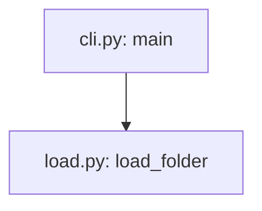

# Writing pages

## Page kinds

Each page serves one purpose, so a reader knows whether they are learning, doing, looking something up, or trying to understand ([Diátaxis](https://diataxis.fr/)). The root README is the front page. Readers never see the kind names: the index and the viewer use the labels documentation sites use.

| Kind | Readers see | Folder | Answers |
|---|---|---|---|
| front page | Start here | the root `README.md` | what is it; how do I set it up, run, test and debug it |
| tutorial | Tutorials | `start/` | walk me through it once |
| explanation | How it works | `concepts/` | how is it put together, and why |
| how-to | Guides | `howto/` | how do I … |
| reference | Reference | `reference/`, or a folder named for the thing, such as `api/` or `cli/` | what exactly does X do; where is X |

`SCHEMA.md` and `log.md` are for the wiki's maintainers. The viewer keeps them out of the reading pages and links them from its footer.

## The overview page

`concepts/overview.md`, titled "How {project} fits together", comes first under "How it works": the whole system on one page. Its sections:

1. **What it does.** What a user gets from the project, as a short list in their words, grouped the way the project groups it (its commands, screens, endpoints or features). Each item links the page that covers it, where one exists.
2. **The parts.** A table `Part | What it does | Built on | Where it lives | How you reach it`. A part is what a newcomer would name: the command line, the API server, the web app, the database, the worker. "Built on" names the framework, library or method that does the part's work (FastAPI, PostgreSQL full-text search, an ISO standard), so a reader knows what to look up.
3. **How they fit.** One diagram of the parts and what passes between them, such as an HTTP request, SQL, a file or a queue message.
4. **One request, end to end.** A typical use followed across the parts in a few numbered steps, each linking the how-it-works page that owns its detail.
5. **The code to know first.** A table `Code | What it decides | Open it when`, under a lead sentence that links the main flow's how-it-works page. Each `Code` cell links the function's file. Rank the rows by how much of the result each function decides: first the functions that compute or decide the project's main result, then the function that runs the flow end to end, then the entry point. Application setup, registries and error plumbing are left out. Readers, agents most of all, name exactly the functions in this table and read it from the top, so each step of the main flow that decides part of the result has one of its functions here, and the table is not grown to hold the rest. When the lint lists a step with none, put its deciding function in place of a row that decides less, or keep the gap with its reason (§What the lint checks).
6. **Where to go next.** Links by task: set it up, debug it, find the code behind a report (the map), change it.

The test: a newcomer who reads only this page can say what each part does, which part to open for a task, and which few functions to read first.

## How-it-works pages

Each core flow gets one page, `concepts/how-<flow>-works.md`, started from `templates/how-it-works.md.tmpl`. A core flow is what the project exists to do: the calculation behind its main result, the path of a request through its server, the loop that schedules its jobs. Most projects have one to three. The page is the one home of that flow's steps, methods and code. Its sections:

1. **What goes in and what comes out**, and the method at the core, in one or two sentences.
2. **Think of it as …** An everyday picture of the flow that a newcomer already understands, such as a library catalogue for a search index, in two to four sentences. A table `In the picture | In the code | Where the picture stops fitting` ties each part of the picture to a step. A picture that fits only loosely misleads; leave the section out rather than force one.
3. **The pipeline.** One diagram from the input to the output and one table under it, each fact in one of the two:
   - The diagram carries the order, the branches and the data. Each box says what the step does, in a few words; each arrow names what passes, with its type or shape.
   - The table carries the rest: `# | Step | Method | Code | In the example`. Method is what the step applies (a named algorithm, a standard and its clause, a formula, a rule such as "retry with back-off"), linked to its source. Code links every function that does the step's work. The example column has the values from a captured run of one real input, so the reader follows numbers through the steps.
4. **Who calls whom.** The call map (§Diagrams, "Call maps"): the functions from the flow's entry to the code that does the work, on the main path and where real logic lives, not every helper. Start it from `python <tools folder>/wiki.py callgraph <path>#<core function>` for Python, which reads the calls from the code. Under the map, a collapsed `<details>` block titled "Every call on this path" keeps the complete list as a table `Caller | Calls`, one row per call, each cell `file: function` (`callgraph … --table` prints it), so a reader asked for every call finds the helpers the map leaves out.
5. **The rules that decide the result.** The formulas (§Formulas), thresholds and decision rules, each with the function it lives in. Where a design document derives them, link it instead of copying the derivation. When the example's result is built from parts and one part decides the verdict (a load factor that pushes a stress past its limit, one stage that takes most of a request's time), show the build-up as a table of the captured values and name that part in one sentence.
6. **Why it is built this way**, only for decisions a reader would otherwise question or undo.

Name a method only as the code or its documents name it: a docstring, a comment, a reference in the code, or a design note. A method you recognise but the project never names is described in words.

The test: from this page alone, a newcomer can name each step, its method and its function, follow the example's values through them, and say where to look when one number in the result is wrong.

## The map of the code

`reference/map.md`, titled "Map of the code", started from `templates/map.md.tmpl`. The other pages go deep on the core flows; this one is wide. Every part of the code has a row, so a reader with a report about anything finds the file to open, including the code no other page covers. Its sections:

1. **Every module, one row.** One table for each part of the overview, `Where | What it does | Open first`:
   - **Where**: the file or folder, as a path from the repository root in code marks.
   - **What it does**: in the words a user would put in a report, such as the screen, command, endpoint, file or message it is responsible for. Code another page explains gets a few words and a link to that page, not a second telling.
   - **Open first**: the function where that behaviour starts, as a link whose text is the symbol and whose target is its file. A folder row links one too: a row that says only "the component named in the report" leaves the reader in a folder.

   A row is a module: a file, or a folder of files that do one job. A folder of like files (one component per screen, one handler per endpoint) is one row that names the pattern, and each file in it with logic of its own (state, calls to the server, storage, validation) gets its own row. The tests are rows too, one per suite or folder, saying which part it checks. Read each module far enough to write its row from the code: what it exports, where it starts, what its docstrings say. The map has no `sources:` list: its rows name the code, and the lint checks each one.
2. **Where the code is not what it seems.** A table `Code | You would expect | What it does`: the places where code differs from its name, its docstring or comment, the contract it declares (an API schema, a type, a help text), or the project's documents. A newcomer debugging from a report trips over exactly these. List the ones you meet while reading for the rows, each checked in the code and linked like "Open first". State the difference as a fact, without judging it. Leave the section out when you found none. The same list goes in your report as things the user may want to fix: the wiki describes the code, it does not change it.

The test: take anything a user can see or any message the program prints; a reader finds its row and opens the right file first.

## Sources page

When the code follows any external source (a standard, a handbook, a paper, a specification, a vendor's API document), write `reference/sources.md`, titled "Standards and sources", from `templates/sources.md.tmpl`. One row per source: its short name as pages cite it, the full citation with the clauses the code uses, where the repository keeps it or notes on it, a public link when one exists, and the pages and functions that use it. Each row's first cell starts with an anchor, `<a id="dnv-cn-41-2"></a>DNV CN 41.2` (the short name in lower case, with letters, digits and hyphens), so a page links straight to that row: `../reference/sources.md#dnv-cn-41-2`. Cite only what the code or its documents name; a source you cannot place in the repository or its documents is reported, not listed.

## Page template

```text
---
title: <name>
kind: tutorial | how-to | reference | explanation
sources: [<path>#<Symbol>, <path>#<Class.method>, <path>]
updated: YYYY-MM-DD
---
# <name>
One or two sentences: what this page answers.
## …sections…
```

`sources:` may also be a block list, one `- <path>#<Symbol>` per line. There is no closing list of sources: the front matter holds them, and the viewer lists them as "Code this page explains". Link a file in the text where the reader needs to open it.

## Rules

- **Sources are symbols, never line numbers.** Write `src/app.py#Engine.run`, `web/server.ts#Router.route`, `README.md#setup` (a heading); a whole file is just its path. Name in `sources:` every symbol the page explains. Python is checked with its parser; other languages are matched against their definition syntax, which can miss an unusual form: then name the enclosing definition.
- **Captured, expected, or illustrative.** Output shown as real was pasted from a run or a file, and says so: "Captured on 2026-10-23 from `app --trace sample.csv`, shortened", or "Captured: `tests/golden/report.txt`". Output worked out from the code, for a command that cannot run here, is labelled "Expected, from `<path>#<Symbol>` (not captured)". Any other example is labelled "Illustrative". Never type output by hand and present it as captured.
- **Plain and exact.** Define a term before using it. Short sentences, active voice. A table for anything a reader looks up.
- **Headings say the point**, in the reader's words, not the name of a rule in the code: "If a setting is set in more than one place", not "Which value wins". Someone who reads only the headings learns what the page says.
- **The consequence first, then the reason.** Open a section with what the reader should do or expect, with one concrete example; the mechanism follows. For example: "Setting `os.environ["LLM_MODEL"]` after the import changes nothing: pass `model=` instead. The value is read once, at import…".
- **One home per fact, said once.** A table, list or procedure is written in full in one place: settings and flags on a reference page, a procedure on its how-to page, setup in the README, a flow's steps on its how-it-works page, where each module lives on the map. Another page gives the part its reader needs for the task at hand, and a link. This holds for the same fact in other words: the overview tells a flow at the level of parts, its how-it-works page owns the steps and the code, run-and-debug owns where to break. Within a page, cut a sentence that restates its heading, the table or diagram beside it, or the page's purpose. The test: a reader finishes a task without opening another page, and a change in the code needs the fact edited in one place.
- **Cite the sources the code follows, with a link.** When a page names a standard, a handbook, a paper or a specification the code implements, the first mention in each section links it, and so does every step's Method cell. A short form is a citation too: "DNV p. 12" and "cl. 1.9.3.2" need the link as much as "DNV CN 41.2". Link a clause to the repository's own document on it (a handbook chapter, a spec), and otherwise to the source's row on `reference/sources.md` by its anchor. Before writing a Method cell, read the docstrings and comments of the step's functions and of the helpers they call: the clause is often there. When neither the code nor the project's documents name a source for a method, say so in the cell ("Method B; the code names no clause"), so the reader does not look for one.
- **Links are relative.** Between pages, `../howto/run-and-debug.md`; to code, the file's relative path; to a section, `page.md#heading-slug`.

## Pictures, tables and charts

Long runs of text are where readers give up. Read each section and ask what the reader has to build in their head to follow it. When it is one of these, show it next to the sentence that explains it:

| To follow the section, the reader must hold | Show it as |
|---|---|
| steps in order, with branches or loops | a flowchart |
| a choice: which rule applies, which path is taken, why a run fails | a decision flowchart, or a table `If \| Then \| Decided in` |
| several things compared on the same properties: commands, features, settings, screens, endpoints | a table, one row per thing. A list of paragraphs that all say the same kinds of things is a table waiting to be drawn |
| a number built from parts: a stress from its factors, a request's time from its stages | its formula (§Formulas), a table of the parts with the example's values, and one sentence naming the part that decides the result |
| a quantity across a range: a factor against speed, latency against load | a short table of values the code computed, or a chart when it passes the test below |
| the states something goes through | a state diagram |
| a screen or a window | a table of its areas, `Area \| What it shows \| What you do there`, or a screenshot of the running program |

Words stay words where they read easily: one or two facts, a single condition, a reason, an idea the reader already knows. A picture never repeats the table beside it: give each its own facts, as the pipeline diagram and its step table do.

Charts are rare. A chart earns its place only when its point is a shape that neither a short table nor one sentence gives: many values with a bend, a crossover, a peak or an outlier. A rule one sentence states (each wait doubles, up to 30 s), a handful of numbers, or which of a few factors is largest stays a sentence or a table. A chart that passes is a Mermaid `xychart-beta` or `pie` block (`xychart-beta horizontal` when the bar labels are longer than a word). Its numbers are evidence: take them from a captured run, or compute them with the project's own functions in a `check:run` block whose `check:output` shows the values, and say under the chart where they come from. A chart is never drawn from numbers typed by hand, and no table repeats it.

## Diagrams

- Write each diagram as a fenced `mermaid` block whose first line is `%% id: <name>` (lowercase letters, digits and hyphens, unique across the wiki). The page shows the rendered SVG and keeps the source in a collapsed block below it: an image shows in every Markdown viewer, while VS Code's built-in preview and many others show a Mermaid block as code. Leave a blank line after the summary line so GitHub renders the block:

````text


<details><summary>Diagram source</summary>


</details>
````

- **Draw what a reader needs to see, in words.** A box names a part ("API server") or a step ("wait, then retry"); an edge says what passes or when ("HTTP JSON", "on a 429"). Worth drawing: the parts and what flows between them (the overview), a flow's pipeline and its call map (its how-it-works page), the steps of a decision or a loop, the states something goes through. Each function-level map is drawn once; other pages link to it.
- **Syntax that parses.** Every node label and edge label in double quotes, with no `;`, `<`, `>` or `#` apart from `<br/>` between the lines of a box. No node id named `end`. In a chart, the title and axis names are quoted (`title "…"`, `x-axis "…" ["a", "b"]`); a `pie` title is not, and each slice is `"label" : value`.
- **A box that names code ends with `file: function`** on its last line, as in `"Dynamic factor<br/>part1_factors.py: kv_method_b"`. The path may be shortened to any tail that names one file, and `a.py: f and g` names two functions.
- **Call maps.** A diagram whose second line is `%% calls` is a call map: each box is `file: function`, and each solid arrow says the first function calls the second. An indirect call (a registry lookup, a callback, a call into another process, a method reached through an object whose type the reader must know) is drawn dotted, `-.->`, with how it is reached on the arrow.
- **Fit a Markdown column.** GitHub and VS Code show a diagram no wider than their text column, about 860 px, and shrink a wider one with its labels; `render` names each diagram whose labels end up too small to read. A chain reads top to bottom (`flowchart TB`). Break a long label over lines with `<br/>`. A decision whose label names code is a box with yes and no arrows, not a diamond, which grows both ways with its label. Split a diagram that is still too wide. Call maps are the exception: draw each in the direction that is narrower; the viewer zooms it, and GitHub opens it full size on a click.
- **Render after every edit**: `wiki_browser.py render` fails on a diagram that does not parse, and writes each SVG at its natural size on a white ground with a hash of its source. A diagram changes in the same change as the code it shows.

## Formulas

A formula the reader has to follow gets its own lines, typeset. A table cell or a sentence keeps only a short relation that reads at a glance (F_t = 2000·T₁/d₁); anything with a root, a fraction of products or a chain of factors moves out under the table, and the cell names it and links to it.

- **One `math` block per idea**, in the order the code computes it: a fenced block with the info string `math` and TeX inside, `\begin{aligned} … \end{aligned}` with `&=` for a chain of lines. GitHub, GitLab, VS Code's built-in preview and the viewer typeset it; any other viewer shows its TeX source, which still reads. Not `$$`, which Markdown mangles where math is not supported.
- **Before it, one sentence on what it computes**, with the function it lives in, linked, and its clause.
- **After it, a table of its symbols**, `Symbol | What it is | In the example`: each symbol in words with its unit, and its value from the captured run, so the reader can redo the arithmetic. Symbols in prose and tables are plain text (`σ_H`, `K_Hβ`). Group symbols that need no explanation on one row; a symbol defined earlier on the page is not defined again.
- **Then the result**, one line with the values the formula gave, and which of them decides the verdict.
- **Only what the code does.** Copy each formula from the function, not from the standard or the design document, and check it against the captured values: a formula that does not reproduce the run's number is wrong. State the constants, floors and branches the code applies in one line under it ("F_m/b at least 100 N/mm"). Formulas the reader does not need to follow the result stay in the design document, linked.
- Use the TeX that KaTeX and MathJax both support: `\frac`, `\sqrt`, `\cdot`, subscripts and superscripts, Greek letters, `\min`, `\text{…}`, `\qquad`, `aligned`. `wiki_browser.py check-viewer` fails on a formula that does not typeset.

````text
**Flank (pitting) stress**, in [`flank_chain`](../../src/rating/part2_flank.py):

```math
\begin{aligned}
\sigma_H &= Z_B\, \sigma_{H0} \sqrt{K_A\, K_v\, K_{H\beta}\, K_{H\alpha}} \\
S_H &= \sigma_{HG} \,/\, \sigma_H
\end{aligned}
```

| Symbol | What it is | In the example |
|---|---|---|
| K_A, K_v, K_Hβ, K_Hα | application, dynamic, face and transverse load factors | 1.25, 1.047, **1.949**, 1.057 |
````

## Command blocks

Every block a reader would paste into a terminal is either checked or skipped with a reason.

| Comment above the block | What `wiki.py lint --run` does |
|---|---|
| `<!-- check:run -->` | runs the `bash` or `powershell` block in a temporary clean checkout; a non-zero exit fails the lint |
| `<!-- check:run os=windows -->` (or `os=posix`, `os=linux,macos`) | the same, on that OS only; elsewhere it is reported as skipped |
| `<!-- check:run exit=1 -->` | the same, for a block that shows a failure on purpose, such as a start-up error in the symptom table: the block passes only if it ends with that exit code. Keep the failing command last |
| `<!-- check:run background ready=http://127.0.0.1:8000/health -->` | starts the block as a service and waits until the URL answers below 500, or until `ready=/regex/` appears in its output, or `wait=<seconds>` passes. The page's later blocks can probe it, and it is stopped with its page |
| `<!-- check:output -->`, above the fenced output that follows a run block | the run block's output must contain these lines in order; `…` matches any text inside a line, and extra lines are allowed |
| `<!-- check:output fill -->`, above a placeholder block for output you could not capture yet | nothing is compared; after `lint --run --capture <folder>`, `wiki.py fill --capture <folder>` writes the captured output in, with run-specific values (temporary paths, times, ids) as `…` and long output kept to its first and last lines, and turns the marker into `check:output`. Review what it wrote and label it "Captured on", the date and the command |
| `<!-- check:skip reason="needs an OpenAI API key" -->` | not run; the reason says what the step needs that a check cannot have. The viewer shows it to the reader above the block, so write it for them |

- Blocks run in order, the README first and then the pages by path, in one clean checkout of the current change, so a later block may use what an earlier one set up. Each block runs as one script and stops at its first failing command. Never add exit-code handling to make a failure pass; mark it `exit=<code>`.
- With `--clean-env` the blocks run with only system variables (PATH, the home and temp folders, proxies). A step that needs a variable sets it in the block or says where the value comes from, such as copying `.env.example`.
- Mark as `check:run` only blocks that are safe to repeat and that finish on their own, apart from `background` services: no deploys to shared systems, no writes outside the checkout, no real credentials. When a stand-in exists (a mocked test, a local server, a dry run), show it as a run block next to the skipped real step.
- Where a step differs by OS, give each form and mark it with `os=…`. A block that installs packages needs network access; say so in the page's prerequisites.
- Output shown under a command is real output marked `check:output`, with values that change on every run replaced by `…`.

## Run and debug

This is the page developers need most. Start from `templates/run-and-debug.md.tmpl`, and fill its sections in this order:

1. **Scope.** One or two sentences, and a link to the README's setup section. When the entry point needs something a default install lacks (`../../references/extraction.md` §2), such as a particular interpreter or a service that must be running, give one line for each: what it is and how to provide it. The full steps stay in the README.
2. **Where to break.** A link to the call map on the how-it-works page, then a table `To see | Break in | Inspect | File`: one row per question a debugger answers (which branch was chosen, what the parsed input looks like, what goes back to the caller), with the variables or expressions worth printing there. When the path from the entry point crosses layers the call map does not draw (a web client, a queue, a server's child process), draw only those layers here, with code that runs in another process (`extraction.md` §6) in a subgraph named for that process.
3. **Run each layer alone**, the fastest first: the core function from a short script or REPL, the command line on a sample input, the service with a test client, the whole system. Each level is one line on what it shows, its command (marked `check:run` when safe), and how to attach a debugger: a named launch configuration, `python -m pdb`, `node --inspect-brk`, `dlv debug`. Add two lines only where they apply:
   - **While paused**: what misbehaves while the program waits at a breakpoint (client timeouts, watchdogs, retries, heartbeats), and the setting that turns each off.
   - **In another process**: a breakpoint in code that runs in another process never stops the debugger attached to the entry point, and nothing tells the reader why. Say where that code runs and how to reach it: the switch that keeps it in one process (a worker count of 1, an in-process mode, `--no-reload`), or how to attach to the other process. If neither exists, say so, and list adding a switch as a recommendation.
4. **Trace.** The switch the code already has (an environment variable or a flag), with a captured sample of its output, one line per stage, and where the output goes when the host hides it. If the code has none, say so, give what the runtime or a library offers without a code change (`GODEBUG`, `NODE_DEBUG`, Python's `-X importtime`, a verbose flag), and list adding a real switch as a recommendation.
5. **When it goes wrong.** A table `Symptom | Likely stage | Check`:
   - first, starting the program the wrong way, which is what a newcomer does first: the default interpreter instead of the one it needs, a required service not running. Give the exact message, or how long it waits, and the fix;
   - then the messages the code raises, the failure modes its tests cover, and the edge cases the code handles silently (a remainder dropped, a cap reached, a division by zero);
   - where a command reproduces the symptom safely, give it, marked `check:run exit=<code>`.

   Under the table, one line sends a report the table does not list to the map (`../reference/map.md`).
6. **Where each output value is set.** Include this when the program writes a structured result (a JSON or CSV file, a report, an API response, database rows). A table `Field | What it holds | Set in`, one row per field a reader would question, derived from the code that writes the field. `Set in` is a link whose text is the symbol and whose target is its file, for example ``[`merge_signals`](../../src/pipeline.py)``, so a wrong value leads straight to the function to break in. When a reference page already describes the format, add the `Set in` column to its table and link it from here.
7. **Debug configurations.** The committed launch configurations by name, and what each runs.

## What the lint checks

`wiki.py lint` reads the pages against the code, so the rules above that name code stay true without a reviewer.

| It fails on | It warns about |
|---|---|
| a broken link or anchor; a page missing from the index | a page whose sources changed since it was last checked |
| a `path#Symbol` in `sources:` that no longer exists | code a table or a diagram names that `sources:` leaves out, so a change to it would not flag the page |
| a symbol linked from a `Set in`, `Open first` or `Code` column, a `file: function` box, or a `Caller \| Calls` row that no longer exists | a `Set in` function that no longer mentions its field; a call-map arrow the caller no longer makes |
| a diagram not rendered from its current source | a source named without a link (in a section, or in a step's Method cell, including one the step's code cites); a link to the sources page that names no row |
| with `--run`: a failing command, or output that no longer matches `check:output` | a main-flow step with no function in the overview's code-to-know-first table; a step table that repeats the diagram's arrows in Takes and Gives columns |
| with `--strict`: a command block neither run nor skipped with a reason | code files that are on no page and under no row of the map, by folder; a folder row of the map that links no code to open first |
| | a table or diagram that repeats another; a `$$` formula; a template placeholder left in |

It also reports the words a reader has to read and the longest pages, so growth is visible; there is no limit, and a page is as long as its facts need.

**A warning that stays.** Fix a warning, or keep it with its reason on the page it is about, where the next maintainer reads it:

```text
<!-- lint:accept "step 5 of concepts/how-search-works.md" reason="it only pages the result; the rows above explain the ranking" -->
```

The quoted text is any part of the warning's message. The lint then lists the warning as kept, with its reason, and reports the line once it matches nothing. Problems cannot be kept.
