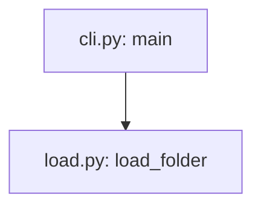

# Writing pages

## Five tests every page passes

The rules below come from five tests. Where no rule covers what you are writing, apply the test.

1. **Like things at like depth.** Whatever the project has several of (commands, endpoints, screens, calculations, jobs) is covered in one shape, every one of them. Where the wiki goes deep on one, it says that this is the worked example, and where the depth for the others is.
2. **Nothing to decode.** Before a formula, a code block, a table, a picture or a folded block, a sentence says what it is and why it is here, and names anything in it the page has not explained.
3. **A place to start and one thing to notice.** A picture or table of many like parts is grouped, shows where to begin, and marks the one part to leave remembering: the part everything passes through, the step that decides the example's result, the function where the number is made. This holds for every picture on every page, not for one kind of diagram.
4. **A route, not a pile.** The index gives the order to read the pages in; each page builds on the ones before it.
5. **Try before reading.** Where a part can be run, called or sent a request, the shortest real use comes first, with its real answer.

## Page kinds

Each page serves one purpose, so a reader knows whether they are learning, doing, looking something up, or trying to understand ([Diátaxis](https://diataxis.fr/)). The root README is the front page. Readers never see the kind names: the index and the viewer use the labels documentation sites use.

| Kind | Readers see | Folder | Answers |
|---|---|---|---|
| front page | Start here | the root `README.md` | what is it; how do I set it up, run, test and debug it |
| tutorial | Tutorials | `start/` | walk me through it once |
| explanation | How it works | `concepts/` | how is it put together, and why |
| how-to | Guides | `howto/` | how do I … |
| reference | Reference | `reference/`, or a folder named for the thing, such as `api/` or `cli/` | what exactly does X do; where is X |

The index opens with the route: the order to read the pages in, one line for each stop saying what the reader can do after it. The viewer shows each page's place on it.

`SCHEMA.md` and `log.md` are for the wiki's maintainers. The viewer keeps them out of the reading pages and links them from its footer.

## The overview page

`concepts/overview.md`, titled "How {project} fits together", comes first under "How it works": the whole system on one page. Its sections:

1. **What it can do.** One capability card (§Capability cards) for each thing a user can ask of the project, grouped the way the project groups them. When the cards run past a screen or two, they move to their own page, `reference/capabilities.md`, titled "What {project} can do", and this section keeps the groups, one line each, linking it.
2. **The parts.** A table `Part | What it does | Built on | Where it lives | How you reach it`. A part is what a newcomer would name: the command line, the API server, the web app, the database, the worker. "Built on" names the framework, library or method that does the part's work (FastAPI, PostgreSQL full-text search, an ISO standard), so a reader knows what to look up.
3. **How they fit.** One picture of the parts and what passes between them, such as an HTTP request, SQL, a file or a queue message, in the form this system has (§Pictures, tables and charts).
4. **One request, end to end.** A typical use followed across the parts in a few numbered steps, each linking the how-it-works page that owns its detail.
5. **The code to know first.** A table `Code | What it decides | Open it when`, under a lead sentence that links the main flow's how-it-works page. Each `Code` cell links the function's file. Rank the rows by how much of the result each function decides: first the functions that compute or decide the project's main result, then the function that runs the flow end to end, then the entry point. Application setup, registries and error plumbing are left out. Readers, agents most of all, name exactly the functions in this table and read it from the top, so each step of the main flow that decides part of the result has one of its functions here, and the table is not grown to hold the rest. When the lint lists a step with none, put its deciding function in place of a row that decides less, or keep the gap with its reason (§What the lint checks).
6. **Where to go next.** Links by task: set it up, debug it, find the code behind a report (the map), change it.

The test: a newcomer who reads only this page can say what each part does, which part to open for a task, and which few functions to read first.

## Capability cards

A capability is one thing a user can ask of the project: a command, a group of endpoints, a screen, a job, a public function of a library. Each gets a card, and every card has the same lines, so no capability is explained while its neighbour is only named:

````text
### `export`: write a report as CSV or a spreadsheet

- **Try it:** `app export examples/sales.json --format csv` writes `sales.csv`, one row per order.
- **How:** rows are grouped by customer, then written by the writer `--format` chooses. A group's total is the sum of quantity × price.
- **Open first:** [`run_export`](../../src/app/export.py) → [`write_csv`](../../src/app/writers.py)
- **Go deeper:** [How an export is built](how-export-works.md), worked step by step.
````

The heading names the capability as the user calls it and what it answers. **Try it** is the shortest real use on an input the repository ships, and what comes back. **How** says how the result comes about, in a sentence or two: the method as the code or its documents name it, then the relation or rule that decides the result, written out and not only named (`total = Σ quantity × price`; "the first rule that matches wins"; "a file over 5 MB is refused"). "Then the totals are computed" tells the reader nothing. What the capability also offers goes in the option table under the card, not here. **Open first** links the function that works the result out, where a breakpoint shows the numbers; when a thin entry point sits in front of it, both, in call order (`run_export` → `write_csv`). **Go deeper** says where its steps are explained: its how-it-works page, else the project's own document on it, else "nothing more is written"; this line tells the reader how deep the wiki goes on each capability.

What only switches on inside another capability (an option, a block of the input, a plug-in) is a row in a table under that card, `Option | Turned on by | What it adds`. The cards do not repeat the map: the map is every module, the cards are every thing a user can ask for.

The test: a reader who cares about any one capability, not only the one the wiki works through, can run it, say how its result comes about, and open its code.

## How-it-works pages

Each core flow gets one page, `concepts/how-<flow>-works.md`, started from `templates/how-it-works.md.tmpl`. A core flow is what the project exists to do: the calculation behind its main result, the path of a request through its server, the loop that schedules its jobs. Most projects have one to three. The page is the one home of that flow's steps, methods and code. Its sections:

1. **What goes in and what comes out**, and the method at the core, in one or two sentences. When other capabilities run through the same skeleton (the same entry point, the same checks, the same shape of result), say so here and name the steps they share, so the reader can carry this page over to them.
2. **Think of it as …** An everyday picture of the flow that a newcomer already understands, such as a library catalogue for a search index, in two to four sentences. A table `In the picture | In the code | Where the picture stops fitting` ties each part of the picture to a step. A picture that fits only loosely misleads; leave the section out rather than force one.
3. **The steps.** One table, always, and one picture in the form this flow has (§Pictures, tables and charts), each fact in one of the two:
   - The table: `# | Step | Method | Code | In the example`. Method is what the step applies (a named algorithm, a standard and its clause, a formula, a rule such as "retry with back-off"), linked to its source. Code links every function that does the step's work. The example column has the values from a captured run of one real input, so the reader follows numbers through the steps. The viewer shows the table as a track of steps, each with its function and its value.
   - The picture carries what a table cannot. Steps that branch or loop are a flowchart: each box starts with its step number, says what the step does in a few words, and ends with its `file: function`; each arrow names what passes, with its type or shape; a flow with more steps than a reader holds at once is drawn in phases (§Diagrams, "Phases"), and the step that decides the example's result is marked. A flow whose parts wait on each other (a client, a server and a store; two processes) is a sequence diagram. A flow that is the life of one thing is a state diagram. A flow that reshapes data shows the example's value at each stage. A straight line of a few steps needs no picture: the table is one.
4. **Who calls whom.** The call map (§Diagrams, "Call maps"): the functions from the flow's entry to the code that does the work, on the main path and where real logic lives, not every helper. Start it from `python <tools folder>/wiki.py callgraph <path>#<core function>` for Python, which reads the calls from the code. Under the map, a collapsed `<details>` block titled "Every call on this path" keeps the complete list as a table `Caller | Calls`, one row per call, each cell `file: function` (`callgraph … --table` prints it), so a reader asked for every call finds the helpers the map leaves out.
5. **The rules that decide the result.** The formulas (§Formulas), thresholds and decision rules, each with the function it lives in. Where a design document derives them, link it instead of copying the derivation. When the example's result is built from parts and one part decides the verdict (one fee that makes up most of a price, one stage that takes most of a request's time), show the build-up as a table of the captured values and name that part in one sentence.
6. **Why it is built this way**, only for decisions a reader would otherwise question or undo.

Name a method only as the code or its documents name it: a docstring, a comment, a reference in the code, or a design note. A method you recognise but the project never names is described in words.

The test: from this page alone, a newcomer can name each step, its method and its function, follow the example's values through them, and say where to look when one number in the result is wrong.

## The map of the code

`reference/map.md`, titled "Map of the code", started from `templates/map.md.tmpl`. The other pages go deep on the core flows; this one is wide. Every part of the code has a row, so a reader with a report about anything finds the file to open, including the code no other page covers. Its sections:

1. **Every module, one row.** One table for each part of the overview, `Where | What it does | Open first`:
   - **Where**: the file or folder, as a path from the repository root in code marks.
   - **What it does**: in the words a user would put in a report, such as the screen, command, endpoint, file or message it is responsible for. Code another page explains gets a few words and a link to that page, not a second telling.
   - **Open first**: the function where that behaviour starts, as a link whose text is the symbol and whose target is its file. A folder row links one too: a row that says only "the component named in the report" leaves the reader in a folder.

   A row is a module: a file, or a folder of files that do one job. A folder of like files (one component per screen, one handler per endpoint) is one row that names the pattern, and each file in it with logic of its own (state, calls to the server, storage, validation) gets its own row. The tests are rows too, one per suite or folder, saying which part it checks. Read each module far enough to write its row from the code: what it exports, where it starts, what its docstrings say. The map has no `sources:` list: its rows name the code, and the lint checks each one.

   A module that answers for several things a report could name (two outputs, several routes, an action and the message it shows, a limit or default a user would quote) names each in `What it does` with the function or constant that decides it, linked like `Open first`: ``the export as CSV ([`write_csv`](…)) and as a spreadsheet ([`write_xlsx`](…))``; ``at most 20 uploads at once ([`MAX_UPLOADS`](…))``. One function to open first is not enough there: a reader sent to the neighbouring function reads the wrong code. The lint checks these links too.
2. **Where the code is not what it seems.** A table `Code | You would expect | What it does`: the places where code differs from its name, its docstring or comment, the contract it declares (an API schema, a type, a help text), or the project's documents. A newcomer debugging from a report trips over exactly these. List the ones you meet while reading for the rows, each checked in the code and linked like "Open first". State the difference as a fact, without judging it. Leave the section out when you found none. The same list goes in your report as things the user may want to fix: the wiki describes the code, it does not change it.

   Where the README or another page states the rule the code departs from (a settings table that lists a variable the code never uses, "the API reads `.env`" when one variable is read from the environment only), add the exception there in a few words, linked to this table. A reader who trusts that sentence never looks here.

The test: take anything a user can see or any message the program prints; a reader finds its row and opens the right file first.

## Limits and defaults

`reference/limits.md`, titled "Limits and defaults": every named number the code decides by (a wait, a cap, a window, a threshold, a default), with the functions that read it and the code's own comment on it. `python <tools folder>/wiki.py limits --write` writes it from the code, so it costs no writing; list it in the index under Reference. A user's "where does that number come from" lands there, for any part of the code.

The table between its two markers is the tool's: change nothing in it. What a number means for a user goes where the reader meets it, in the map row of its module or on its flow's page. A number the code uses without a name (a literal in a condition, a slice) is in no table: the map row or the step that applies it says it.

## Sources page

When the code follows any external source (a standard, a handbook, a paper, a specification, a vendor's API document), write `reference/sources.md`, titled "Standards and sources", from `templates/sources.md.tmpl`. One row per source: its short name as pages cite it, the full citation with the clauses the code uses, where the repository keeps it or notes on it, a public link when one exists, and the pages and functions that use it. Each row's first cell starts with an anchor, `<a id="rfc-9457"></a>RFC 9457` (the short name in lower case, with letters, digits and hyphens), so a page links straight to that row: `../reference/sources.md#rfc-9457`. Cite only what the code or its documents name; a source you cannot place in the repository or its documents is reported, not listed.

## An API page

When other programs call the project (an HTTP or RPC service, a library's public functions), the reference page for that interface, `reference/api.md`, starts with `## Try it`:

- **A service**, in this order: the explorer the server itself offers and its address (a Swagger or GraphiQL page, an admin console; read the code for it, and say when it is switched off); how to sign in, as one request; two or three requests a newcomer would send first, a read and a write among them, as `curl` blocks with the answers captured from a run (§Command blocks: a `background` service, then `check:run` and `check:output`, or `check:skip` with what the service needs); the contract (an OpenAPI file or URL, a GraphQL schema, `.proto` files), which tools such as Postman import.
- **A library**: the smallest script that imports it and makes one call, with its output.

The reference follows: every endpoint or public function, grouped as the code groups them, each with the function that serves it. A server that only the project's own front end calls gets this page too.

## Page template

```text
---
title: <name>
kind: tutorial | how-to | reference | explanation
sources: [<path>#<Symbol>, <path>#<Class.method>, <path>]
updated: YYYY-MM-DD
---
# <name>
One or two sentences: what this page answers.
## …sections…
```

`sources:` may also be a block list, one `- <path>#<Symbol>` per line. There is no closing list of sources: the front matter holds them, and the viewer lists them as "Code this page explains". Link a file in the text where the reader needs to open it.

## Rules

- **Sources are symbols, never line numbers.** Write `src/app.py#Engine.run`, `web/server.ts#Router.route`, `README.md#setup` (a heading); a whole file is just its path. Name in `sources:` every symbol the page explains. Python is checked with its parser; other languages are matched against their definition syntax, which can miss an unusual form: then name the enclosing definition.
- **Captured, expected, or illustrative.** Output shown as real was pasted from a run or a file, and says so: "Captured on 2026-10-23 from `app --trace sample.csv`, shortened", or "Captured: `tests/golden/report.txt`". Output worked out from the code, for a command that cannot run here, is labelled "Expected, from `<path>#<Symbol>` (not captured)". Any other example is labelled "Illustrative". Never type output by hand and present it as captured.
- **Plain and exact.** Define a term before using it. Short sentences, active voice. A table for anything a reader looks up.
- **Code on a page is read before it is run.** The sentence before a block that calls the project's own code (a short script, a REPL session) says what the block shows, and names each call the page has not explained: what it does, and what happens without it ("`init_db()` creates the tables; without it the first query fails").
- **Headings say the point**, in the reader's words, not the name of a rule in the code: "If a setting is set in more than one place", not "Which value wins". Someone who reads only the headings learns what the page says.
- **The consequence first, then the reason.** Open a section with what the reader should do or expect, with one concrete example; the mechanism follows. For example: "Setting `os.environ["LLM_MODEL"]` after the import changes nothing: pass `model=` instead. The value is read once, at import…".
- **A word that closes a door is a claim about every path.** "Only on a `.doc`", "every command", "once per document", "until the service restarts", "at most 5 minutes": before writing one, read the other branches. Where they differ, give the main case and name the exception. A summary line on a card or in the overview says no more than the page it summarises.
- **One home per fact, said once.** A table, list or procedure is written in full in one place: settings and flags on a reference page, a procedure on its how-to page, setup in the README, a flow's steps on its how-it-works page, where each module lives on the map. Another page gives the part its reader needs for the task at hand, and a link. This holds for the same fact in other words: the overview tells a flow at the level of parts, its how-it-works page owns the steps and the code, run-and-debug owns where to break. Within a page, cut a sentence that restates its heading, the table or diagram beside it, or the page's purpose. The test: a reader finishes a task without opening another page, and a change in the code needs the fact edited in one place.
- **Cite the sources the code follows, with a link.** When a page names a standard, a handbook, a paper or a specification the code implements, the first mention in each section links it, and so does every step's Method cell. A short form is a citation too: "RFC 9457 §3" and "§3.1.2" need the link as much as "RFC 9457". Link a clause to the repository's own document on it (a handbook chapter, a spec), and otherwise to the source's row on `reference/sources.md` by its anchor. Before writing a Method cell, read the docstrings and comments of the step's functions and of the helpers they call: the clause is often there. When neither the code nor the project's documents name a source for a method, say so in the cell ("Method B; the code names no clause"), so the reader does not look for one.
- **Links are relative.** Between pages, `../howto/run-and-debug.md`; to code, the file's relative path; to a section, `page.md#heading-slug`.

## Pictures, tables and charts

Long runs of text are where readers give up. Read each section and ask what the reader has to build in their head to follow it, and show that next to the sentence that explains it.

**The form follows the thing shown, not the page's outline.** The sections above say where a picture goes; this project decides what it is. A set of services that call each other, a tool that reshapes a file and a calculation do not get the same drawings. Before drawing, say in one sentence what the reader will see that the words did not give them, then take the form whose shape is the shape of that answer:

| To follow the section, the reader must see | Show it as |
|---|---|
| steps in order, with branches or loops | a flowchart |
| a conversation: parts that take turns, wait for an answer or work at once (a browser, a server and a database; a client and a device; two processes) | a sequence diagram: one column for each part, time running down |
| the life of one thing: an order, a job, a connection, a document | a state diagram: its states, and what moves it from one to the next |
| things that are stored and how they point at each other | an entity diagram (`erDiagram`): one box for each table or record, with the fields a reader meets and the links |
| kinds of one thing and what each adds: writers, plug-ins, strategies | a class diagram, or a table when there is nothing but the list |
| when things happen: waits and time-outs, a schedule, how long a cached value lives | a timeline |
| what a value looks like before and after: a parsed document, a record on its way through | the real value at each stage, as short blocks in order, each under the step that made it |
| where things live | a tree of the folders, with a few words on each line |
| what a symbol, a field or an area is on the thing itself: a dimension on a part, the regions of a page or a screen, the bytes of a record | the project's own figure or a screenshot, else a figure (§Figures); `packet-beta` for bytes; a table of areas |
| a choice: which rule applies, which path is taken, why a run fails | a decision flowchart, or a table `If \| Then \| Decided in` |
| several things compared on the same properties: commands, features, settings, screens, endpoints | a table, one row per thing. A list of paragraphs that all say the same kinds of things is a table waiting to be drawn |
| a number built from parts: a price from its fees, a request's time from its stages | its formula (§Formulas), a table of the parts with the example's values, and one sentence naming the part that decides the result |
| a quantity across a range: a factor against speed, latency against load | a short table of values the code computed, or a chart when it passes the test below |
| a screen or a window | a table of its areas, `Area \| What it shows \| What you do there`, or a screenshot of the running program |

The table is a start, not a fence. `render` draws every kind of Mermaid diagram in the wiki's look, and a form not listed is the right one when it is how someone who knows this project would draw it on a whiteboard. Hold each picture to two checks:

- **Cover the words.** If the shape that is left would fit any project (boxes in a row, a fan of arrows from one box), the picture shows nothing this project has. Find what is particular here (the loop, the two things that happen at once, the one store everything reads, the step where the shape of the data changes) and draw that, in the form that shows it, or leave the picture out.
- **Look at it.** `render` writes a PNG of every picture it draws and says where. Open each one you drew or changed: the reader sees the drawing, not its source, and words on top of each other, one box crowding out the rest or a picture that is mostly empty show only there.

When every picture of a wiki has the same form, they were probably drawn from the outline: the lint counts the pictures by kind, so read that line.

Words stay words where they read easily: one or two facts, a single condition, a reason, an idea the reader already knows. A picture never repeats the table beside it: give each its own facts, as a flow's picture and its step table do.

Charts are rare. A chart earns its place only when its point is a shape that neither a short table nor one sentence gives: many values with a bend, a crossover, a peak or an outlier. A rule one sentence states (each wait doubles, up to 30 s), a handful of numbers, or which of a few factors is largest stays a sentence or a table. A chart that passes is a Mermaid `xychart-beta` or `pie` block (`xychart-beta horizontal` when the bar labels are longer than a word). Its numbers are evidence: take them from a captured run, or compute them with the project's own functions in a `check:run` block whose `check:output` shows the values, and say under the chart where they come from. A chart is never drawn from numbers typed by hand, and no table repeats it.

## Diagrams

- Write each diagram as a fenced `mermaid` block whose first line is `%% id: <name>` (lowercase letters, digits and hyphens, unique across the wiki). The page shows the rendered SVG and keeps the source in a collapsed block below it: an image shows in every Markdown viewer, while VS Code's built-in preview and many others show a Mermaid block as code. The viewer shows the picture alone. Leave a blank line after the summary line so GitHub renders the block:

````text


<details><summary>Diagram source</summary>


</details>
````

- **Draw what a reader needs to see, in words.** A box names a part ("API server") or a step ("wait, then retry"); an edge says what passes or when ("HTTP JSON", "on a 429"). Worth drawing: the parts and what flows between them (the overview), a flow's steps and its call map (its how-it-works page), the steps of a decision or a loop, who waits for whom, the states something goes through. Each function-level map is drawn once; other pages link to it.
- **Syntax that parses.** In a flowchart, every node label and edge label in double quotes, with no `;`, `<`, `>` or `#` apart from `<br/>` between the lines of a box. No node id named `end`. In a chart, the title and axis names are quoted (`title "…"`, `x-axis "…" ["a", "b"]`); a `pie` title is not, and each slice is `"label" : value`.
- **A box that names code ends with `file: function`** on its last line, as in `"3 Price the order<br/>pricing.py: price_order"`. The path may be shortened to any tail that names one file, and `a.py: f and g` names two functions.
- **Call maps.** A diagram whose second line is `%% calls` is a call map: each box is `file: function`, and each solid arrow says the first function calls the second. An indirect call (a registry lookup, a callback, a call into another process, a method reached through an object whose type the reader must know) is drawn dotted, `-.->`, with how it is reached on the arrow.
- **Phases.** Group the steps of a longer flow into a few named phases, each a `subgraph` whose title says what the phase achieves ("Read the input", "Score the candidates"). Draw the input and the output as rounded boxes, `IN(["…"])`, so the start and the end stand out. Join phase to phase, not box to box (`P1 -->|"what passes"| P2`), and give each phase `direction LR`: Mermaid then sets the steps of a phase side by side and stacks the phases, which fits a Markdown column. When one step decides the example's result, it is the picture's `%% key:`.

  ````text
  ```mermaid
  %% id: how-export-works
  %% key: S3
  %% legend: key = the totals are made here
  flowchart TB
      IN(["a report file"]) --> P1
      subgraph P1["Read the input"]
        direction LR
        S1["1 Parse the file<br/>load.py: read_report"] -->|"rows: list of dict"| S2["2 Drop empty rows<br/>load.py: clean"]
      end
      subgraph P2["Work out the result"]
        direction LR
        S3["3 Group and sum<br/>export.py: group_rows"]
      end
      P1 -->|"rows"| P2
      P2 --> OUT(["a CSV file"])
  ```
  ````
- **Say what the picture means; `render` draws it.** Every flowchart comes out in one look: groups as tinted bands, the box to notice filled, the way to it coloured where the picture branches, a title line and a code line in each box, a legend. The source gives the meaning in plain Mermaid and never a colour, `style`, `classDef` or `linkStyle`:
  - `%% key: <node id>`: the one box to leave remembering (test 3). A picture with more than a handful of boxes has one. `%% key: none` says that no box matters more than the others; then ask whether the picture is a list drawn as boxes, which a table shows better.
  - `subgraph`: the groups of a picture of many parts, each named for what its members share (the layers of a system, the phases of a flow). Where Mermaid would spread the groups apart because arrows cross them, `render` draws the picture without the bands and shows each group by colour.
  - `-.->`: something that comes back or is reached indirectly (a result, a reply, a lookup). `==>`: only where one route is the point of the picture, such as the way a request goes in.
  - `class <ids> stop` and `class <ids> ok`: the ends of a decision that refuse or fail, and the ends that succeed. An end is named for its outcome and carries no step number.
  - `%% legend: key = …; thick = …; dashed = …; stop = …; ok = …`: a few words for each of these the picture uses, printed under it. The key's words say why it is the one to notice ("every request passes through here").
  - A box whose text has a `<br/>` starts with its title: the part or step in a few words, then what it is made of or its `file: function`.
  Because the look is not in the source, a change in the code is a change to a line of text, and the picture is drawn again.
- **Fit a Markdown column.** GitHub and VS Code show a diagram no wider than their text column, about 860 px, and shrink a wider one with its labels; `render` names each diagram whose labels end up too small to read. A chain reads top to bottom (`flowchart TB`). Break a long label over lines with `<br/>`. A question is `ID{"…?"}` with yes and no arrows; `render` draws it as a flat six-sided box, since Mermaid's diamond grows both ways with its text. Split a diagram that is still too wide. Call maps are the exception: draw each in the direction that is narrower; the viewer zooms it, and GitHub opens it full size on a click.
- **Other kinds than a flowchart** keep Mermaid's own drawing in the wiki's colours, and need less from the source:
  - Labels are written without quotes there: a message, a note, a state, a title.
  - A part that is code names it on its second line, `participant A as API server<br/>api/orders.py: create_order`; the lint checks it like a flowchart's box.
  - A `Note` is the one thing to notice, drawn in the colour of a flowchart's marked box. A picture full of notes marks nothing.
  - A sequence diagram follows one real request or run, in the words of its messages (`POST /orders`, `order id 4182`), not every path the code can take; `alt` and `loop` hold the branch that matters. A state diagram runs top to bottom.
- **Render after every edit**: `wiki_browser.py render` fails on a diagram that does not parse, and writes each SVG at its natural size on a white ground with a hash of its source, and a PNG of it to look at. A diagram changes in the same change as the code it shows.

## Figures

Some things are neither steps nor boxes: where the symbols of a formula sit on the part, the areas of a page a parser reads, how a screen is laid out. Show the project's own picture first: a figure in its documents, a plot or drawing the program itself writes, a screenshot of it running. Link it where it lives.

When there is none, draw a figure: an SVG file in `figures/` beside `diagrams/`, shown as a diagram's image is, ``.

- **It shows the thing, not the code**, so it stays true when the code is refactored. Every label is a name the page uses: a symbol of the formula beside it, a field, an area, each placed as the code or its documents define it. What you know of the subject but this project does not say is not drawn (rule 1: every claim is traceable).
- **A few plain shapes**, with "not to scale" under it when it is not. The file starts `<svg xmlns="http://www.w3.org/2000/svg" viewBox="0 0 <width> <height>">`, no wider than a Markdown column, and holds only shapes and text.
- **Shapes carry a class and never a colour**; `render` writes the look into the file, so every figure is drawn like the diagrams:

  | Class | For |
  |---|---|
  | `part`, `part2`, `part3` | the things shown, one class for each kind |
  | `key` | the one thing to notice: on a shape, a line or a text |
  | `line`, `arrow`, `dim` | an outline; a pointer; a dimension line, tipped at both ends |
  | `axis`, `ghost` | a centre line; what is hidden, left out or ignored |
  | `sym`, `quiet`, `title` | on text: a formula's symbol; a remark; a heading |

- `render` fails on a figure that is not well-formed, and the lint warns about one no page shows. Look at its PNG as you would a diagram's.

## Formulas

A formula the reader has to follow gets its own lines, typeset. A table cell or a sentence keeps only a short relation that reads at a glance (wait = base · 2ⁿ); anything with a root, a fraction of products or a chain of factors moves out under the table, and the cell names it and links to it.

- **One `math` block per idea**, in the order the code computes it: a fenced block with the info string `math` and TeX inside. A chain of lines is `\begin{align} … \end{align}` with `&=`, each line ending in its number, `\tag{1}`, `\tag{2}`. GitHub, GitLab, VS Code's built-in preview and the viewer typeset it; any other viewer shows its TeX source, which still reads. Not `$$`, which Markdown mangles where math is not supported.
- **Before it, what it computes and where it comes from**: one sentence on what the block works out, the function it lives in, linked, and the source the code or its documents name for it (a standard and its clause, a paper, a section of the design document), linked. Where they name none, say that the code names no source.
- **Under a block of several lines, how they follow**: a numbered line for each line of the block, under the number the line carries, saying what it is (the delay before the cap; the cap; the random share of it that is waited). A number under a block points at a `\tag` in it, never at nothing. Where the source gives the reason for a shape the reader would stop at (a root, an exponent, a cap), give it in a few words. The reader sees how one line leads to the next, not a list of equations.
- **After it, a table of its symbols**, `Symbol | What it is | In the example`: each symbol in words with its unit, and its value from the captured run, so the reader can redo the arithmetic. Symbols in prose and tables are plain text (`d_max`, `t_n`). Group symbols that need no explanation on one row; a symbol defined earlier on the page is not defined again.
- **Then the result**, one line with the values the formula gave, and which of them decides the verdict.
- **Only what the code does.** Copy each formula from the function, not from the standard or the design document, and check it against the captured values: a formula that does not reproduce the run's number is wrong. State the constants, floors and branches the code applies in one line under it ("the delay is never below 50 ms"). Formulas the reader does not need to follow the result stay in the design document, linked.
- Use the TeX that KaTeX and MathJax both support: `\frac`, `\sqrt`, `\cdot`, subscripts and superscripts, Greek letters, `\min`, `\text{…}`, `\qquad`, `align` with `\tag`. `wiki_browser.py check-viewer` fails on a formula that does not typeset.

````text
**Wait before a retry**, in [`backoff`](../../src/client/retry.py), the "full jitter" scheme of [Exponential Backoff and Jitter](sources.md#aws-backoff):

```math
\begin{align}
d_n &= \min\left(d_{\max},\ d_0 \cdot 2^{\,n}\right) \tag{1} \\
t_n &= u \cdot d_n, \qquad u \sim U(0, 1) \tag{2}
\end{align}
```

1. The delay doubles with each attempt, up to a cap, so a long outage does not grow the wait without bound.
2. The wait is a random share of that delay, so clients that failed together do not retry together.

| Symbol | What it is | In the example |
|---|---|---|
| d_0, d_max, n | the first delay, the cap, the attempt counted from 0 | 0.5 s, 30 s, **3** |
````

## Command blocks

Every block a reader would paste into a terminal is either checked or skipped with a reason.

| Comment above the block | What `wiki.py lint --run` does |
|---|---|
| `<!-- check:run -->` | runs the `bash` or `powershell` block in a temporary clean checkout; a non-zero exit fails the lint |
| `<!-- check:run os=windows -->` (or `os=posix`, `os=linux,macos`) | the same, on that OS only; elsewhere it is reported as skipped |
| `<!-- check:run exit=1 -->` | the same, for a block that shows a failure on purpose, such as a start-up error in the symptom table: the block passes only if it ends with that exit code. Keep the failing command last |
| `<!-- check:run background ready=http://127.0.0.1:8000/health -->` | starts the block as a service and waits until the URL answers below 500, or until `ready=/regex/` appears in its output, or `wait=<seconds>` passes. The page's later blocks can probe it, and it is stopped with its page |
| `<!-- check:output -->`, above the fenced output that follows a run block | the run block's output must contain these lines in order; `…` matches any text inside a line, and extra lines are allowed |
| `<!-- check:output fill -->`, above a placeholder block for output you could not capture yet | nothing is compared; after `lint --run --capture <folder>`, `wiki.py fill --capture <folder>` writes the captured output in, with run-specific values (temporary paths, times, ids) as `…` and long output kept to its first and last lines, and turns the marker into `check:output`. Review what it wrote and label it "Captured on", the date and the command |
| `<!-- check:skip reason="needs an OpenAI API key" -->` | not run; the reason says what the step needs that a check cannot have. The viewer shows it to the reader above the block, so write it for them |

- Blocks run in order, the README first and then the pages by path, in one clean checkout of the current change, so a later block may use what an earlier one set up. Each block runs as one script and stops at its first failing command. Never add exit-code handling to make a failure pass; mark it `exit=<code>`.
- With `--clean-env` the blocks run with only system variables (PATH, the home and temp folders, proxies). A step that needs a variable sets it in the block or says where the value comes from, such as copying `.env.example`.
- Mark as `check:run` only blocks that are safe to repeat and that finish on their own, apart from `background` services: no deploys to shared systems, no writes outside the checkout, no real credentials. When a stand-in exists (a mocked test, a local server, a dry run), show it as a run block next to the skipped real step.
- Where a step differs by OS, give each form and mark it with `os=…`. A block that installs packages needs network access; say so in the page's prerequisites.
- Output shown under a command is real output marked `check:output`, with values that change on every run replaced by `…`.

## Run and debug

This is the page developers need most. Start from `templates/run-and-debug.md.tmpl`, and fill its sections in this order:

1. **Scope.** One or two sentences, and a link to the README's setup section. When the entry point needs something a default install lacks (`../../references/extraction.md` §2), such as a particular interpreter or a service that must be running, give one line for each: what it is and how to provide it. The full steps stay in the README.
2. **Debug any part.** A table `Part | Start it under a debugger | Then break in`, one row for each part of the overview that runs on its own: a server, the command line, the web app, a worker, a script, the tests. `Start it` is the launch configuration by name or the debugger command, written so it serves every command or input of that part (`python -m pdb -m app.cli <command> <input>`), then one line that runs as written on an input the repository ships, and where the other shipped inputs are. `Then break in` links the part's section of the map. The sections below go deep on the main flow; this table is the way in for a report about anything else.
3. **Where to break.** A link to the call map on the how-it-works page, then a table `To see | Break in | Inspect | File`: one row per question a debugger answers (which branch was chosen, what the parsed input looks like, what goes back to the caller), with the variables or expressions worth printing there. When the path from the entry point crosses layers the call map does not draw (a web client, a queue, a server's child process), draw only those layers here, with code that runs in another process (`extraction.md` §6) in a subgraph named for that process.
4. **Run each layer alone**, the fastest first: the core function from a short script or REPL, the command line on a sample input, the service with a test client, the whole system. Each level is one line on what it shows, its command (marked `check:run` when safe), and how to attach a debugger: a named launch configuration, `python -m pdb`, `node --inspect-brk`, `dlv debug`. Add two lines only where they apply:
   - **While paused**: what misbehaves while the program waits at a breakpoint (client timeouts, watchdogs, retries, heartbeats), and the setting that turns each off.
   - **In another process**: a breakpoint in code that runs in another process never stops the debugger attached to the entry point, and nothing tells the reader why. Say where that code runs and how to reach it: the switch that keeps it in one process (a worker count of 1, an in-process mode, `--no-reload`), or how to attach to the other process. If neither exists, say so, and list adding a switch as a recommendation.
5. **Trace.** The switch the code already has (an environment variable or a flag), with a captured sample of its output, one line per stage, and where the output goes when the host hides it. If the code has none, say so, give what the runtime or a library offers without a code change (`GODEBUG`, `NODE_DEBUG`, Python's `-X importtime`, a verbose flag), and list adding a real switch as a recommendation.
6. **When it goes wrong.** A table `Symptom | Likely stage | Check`; a stage named as a step links the step's page:
   - first, starting the program the wrong way, which is what a newcomer does first: the default interpreter instead of the one it needs, a required service not running. Give the exact message, or how long it waits, and the fix;
   - then the messages the code raises, the failure modes its tests cover, and the edge cases the code handles silently (a remainder dropped, a cap reached, a division by zero);
   - where a command reproduces the symptom safely, give it, marked `check:run exit=<code>`.

   Under the table, one line sends a report the table does not list to the map (`../reference/map.md`).
7. **Where each output value is set.** Include this when the program writes a structured result (a JSON or CSV file, a report, an API response, database rows). A table `Field | What it holds | Set in`, one row per field a reader would question. `Set in` names the function that works the value out, where a breakpoint shows it being decided; a function that only copies it into the result is not that function. It is a link whose text is the symbol and whose target is its file, for example ``[`merge_signals`](../../src/pipeline.py)``, so a wrong value leads straight to the function to break in. When a reference page already describes the format, add the `Set in` column to its table and link it from here.
8. **Debug configurations.** The committed launch configurations by name, and what each runs.

## What the lint checks

`wiki.py lint` reads the pages against the code, so the rules above that name code stay true without a reviewer.

| It fails on | It warns about |
|---|---|
| a broken link or anchor; a page missing from the index | a page whose sources changed since it was last checked |
| a `path#Symbol` in `sources:` that no longer exists | code a table or a diagram names that `sources:` leaves out, so a change to it would not flag the page |
| a symbol linked from a `Set in`, `Open first` or `Code` column, from a map row's `What it does`, a `file: function` box, or a `Caller \| Calls` row that no longer exists | a `Set in` function that no longer mentions its field; a call-map arrow the caller no longer makes |
| a diagram not rendered from its current source | a source named without a link (in a section, or in a step's Method cell, including one the step's code cites); a link to the sources page that names no row |
| with `--run`: a failing command, or output that no longer matches `check:output` | a main-flow step with no function in the overview's code-to-know-first table; a step table that repeats the diagram's arrows in Takes and Gives columns |
| with `--strict`: a command block neither run nor skipped with a reason | code files that are on no page and under no row of the map, by folder; a folder row of the map that links no code to open first; a run-and-debug page with no `Part \| Start it under a debugger` table |
| | a table or diagram that repeats another; a `$$` formula; a template placeholder left in |
| | a flowchart of many boxes with no `%% key:`, a key that names no box, colours written by hand, thick arrows the legend does not name; a formula of several lines without `\tag` numbers |
| a figure not given its look by `render` | a figure with colours written by hand; a figure no page shows |
| a limits table older than the code | named limits in the code on no page, when the wiki has no limits page |

It also reports the pictures by kind, the words a reader has to read and the longest pages, so growth is visible; there is no limit, and a page is as long as its facts need.

**A warning that stays.** Fix a warning, or keep it with its reason on the page it is about, where the next maintainer reads it:

```text
<!-- lint:accept "step 5 of concepts/how-search-works.md" reason="it only pages the result; the rows above explain the ranking" -->
```

The quoted text is any part of the warning's message. The lint then lists the warning as kept, with its reason, and reports the line once it matches nothing. Problems cannot be kept.
